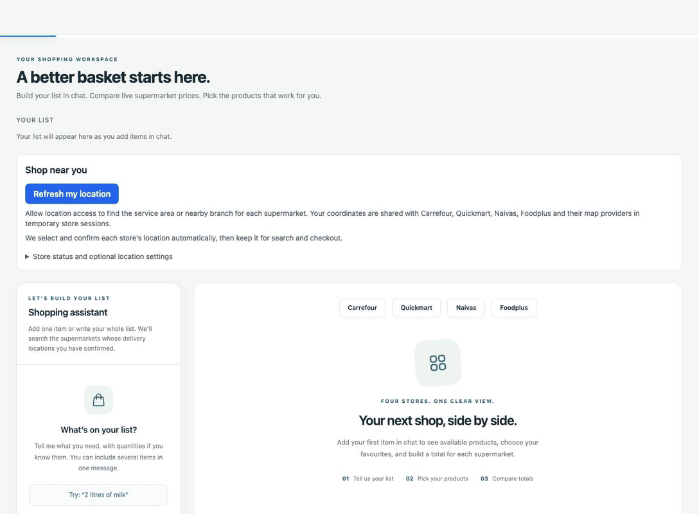
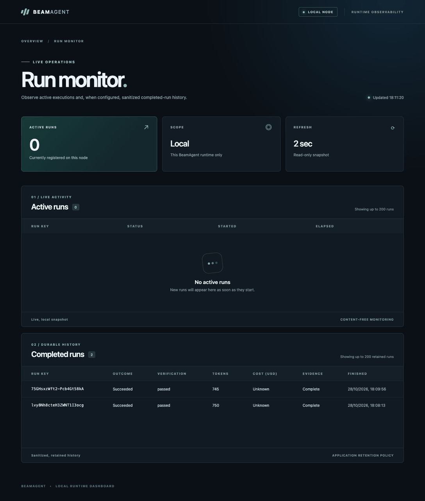

# DealAgent

An Elixir/Phoenix shopping workspace for comparing Kenyan supermarket products.
Write a shopping list in prose, choose the supermarkets to compare, select a
product for each item and review each store's selected subtotal in KES.

Supported stores: **Carrefour, Quickmart, Naivas and Foodplus (Chandarana)**.
Results depend on the store's availability and delivery-location confirmation.

## See the app

Recorded against the running app on 28 October 2026 using real OpenAI and
Carrefour responses. Playwright supplies simulated GPS for the public Greatwall
Gardens/Pridelands area; store confirmation and product data are live. Carrefour
returned 60 candidates. Selecting 250 ml milk at KES 46 produced eight packs and
a KES 368 total for the 2-litre request. Prices are capture-time observations.
Waiting is accelerated; no product responses or token counts are mocked.

The separate BeamAgent view shows live execution and retained completed runs,
with provider-reported tokens, verification and evidence status. Cost remains
unknown without an application price schedule. These captures stop at selection
and observability; they do not demonstrate checkout or payment.

[Selected basket screenshot](docs/images/live-carrefour-basket.jpg) ·
[Completed runs screenshot](docs/images/completed-agent-runs.jpg) ·
[Agent flow, tool calling and guardrails](docs/agent-flow.md) ·
[Render deployment guide](docs/deploy-render.md) ·
[Online checkout design](docs/online-shopping-flow.md)

## How the agent is used

`ShoppingAgent` calls `BeamAgent.API.run/2` to turn a message into a structured
shopping intent. Its only registered tool is **`capture_intent`**. BeamAgent
limits each run to three iterations, one tool call and a 100-second execution
budget, and requires the intent tool to have been called before accepting a run.
The application then validates item quantities, units and supermarket names.

Supermarket searches are **ordinary Elixir calls through per-store browser
queues**, not model tool calls. Headless Firefox or Chromium fetches the store's
pages; adapters parse and normalize products. The shopper chooses the equivalent
product. Decimal arithmetic determines whole-pack costs and selected subtotals;
the language model does not invent prices or calculate the basket.

## Run locally

Install Elixir/Erlang, PostgreSQL and Node.js, then:

  * Run `mix setup` to install and setup dependencies
  * Run `npm ci --prefix priv/carrefour_browser`
  * Install browsers with `cd priv/carrefour_browser && npx playwright install --with-deps chromium firefox`
  * Set `OPENAI_API_KEY` in the server's environment before starting it. Do not commit the key.
  * Start Phoenix endpoint with `mix phx.server` or inside IEx with `iex -S mix phx.server`

Now you can visit [`localhost:4000`](http://localhost:4000) from your browser.

For the friends beta, use the [Render Docker deployment guide](docs/deploy-render.md).
The online preview supports comparison and selection; desktop-only checkout
controls are disabled until a remote-browser handoff is implemented. Foodplus
currently supports comparison only, including in local mode.

## Learn more

  * Official website: https://www.phoenixframework.org/
  * Guides: https://hexdocs.pm/phoenix/overview.html
  * Docs: https://hexdocs.pm/phoenix
  * Forum: https://elixirforum.com/c/phoenix-forum
  * Source: https://github.com/phoenixframework/phoenix

## Agent run logging

BeamAgent 0.3.x supplies the structured telemetry-to-Logger bridge. It is enabled
in `config/config.exs` with `config :beam_agent, :structured_logging, true`.
Restart `mix phx.server` after upgrading so BeamAgent attaches its supervised
logging handler.

Console logs are JSON lines in development and production. Run lifecycle records
include `beam_agent_event` (`beam_agent.run.start`, `beam_agent.run.stop`, or
`beam_agent.run.exception`) and an opaque `run_key` for correlation. Terminal
records include outcome, execution/verification status, iteration/tool-call
counts and error classification where available. Durations retain the package's
native `duration` and add `duration_ms`; timestamps are UTC. Verification,
compression and guardrail records currently do not carry a run key.

The formatter retains only an explicit operational metadata allowlist, including
Phoenix `request_id`. BeamAgent's bridge excludes prompts, shopping requests,
tool arguments/results, model responses and raw exception details. Ordinary app
messages remain ordinary app messages, encoded as JSON; this is not a general
redactor for arbitrary text logged elsewhere.

BeamAgent emits these events at info level. Tests keep the application's warning
threshold, while logging tests explicitly capture info events. To inspect agent
records from a saved console log, filter for a non-null `beam_agent_event` and
then group lifecycle events by `run_key`.

See the installed package's `deps/beam_agent/README.md` and
`deps/beam_agent/docs/structured-logging.md`. Development mode also enables the
local BeamAgent dashboard and sanitized PostgreSQL history described below.
The production beta does not enable these local-only features.

## Completed agent runs and token usage

Run `mix ecto.migrate`, restart Phoenix, then open
[BeamAgent run monitor](http://127.0.0.1:4080/). Submit shopping requests in the
app; active runs appear while executing, and completed summaries include
verification, total provider-reported tokens and evidence status. The adapter
forwards OpenAI input/output usage; it never estimates tokens from text. Its
local acknowledgement reports zero tokens because it makes no provider request.
Missing provider usage remains unknown.

The dashboard is BeamAgent's separate loopback-only listener, not Phoenix's
`/dev/dashboard`. History is retained for 24 hours in the development database;
expired records are hidden. To physically remove expired evidence, run
`mix run -e 'BeamAgent.Trace.Store.prune_expired()'`. Stored summaries and trace
steps omit prompts, shopping items, tool payloads and credentials. Cost stays
**Unknown** until an application-owned, versioned model price schedule is set.
The dashboard is not exposed on the Render service.

## Supermarket search logging

The existing per-supermarket browser queues emit `supermarket.search.queued`,
`supermarket.search.start`, and `supermarket.search.stop` JSON log events at info
level. They use `search_event` and a unique opaque `search_id`, independent of
BeamAgent's `run_key`. These cover the normal headless search path for Carrefour,
Quickmart and Naivas; direct HTTP clients or injected test clients that bypass
the browser queues are outside this instrumentation.

Each record identifies the supermarket, pending `queue_depth` when queued or
started, and `queue_wait_ms`. Terminal records report `outcome` (`ok`, `error`,
or `cancelled`), execution `duration_ms` for started work, and `product_count`
for successful parsed responses (including zero). Failures have a bounded
`error_type`; browser HTTP failures may include a numeric `http_status`.
Cancellation before dispatch is marked `phase: queued` without an execution
duration. Active cancellation, worker failure, queue shutdown and the existing
60-second worker timeout are terminal events, too. A request ID is carried
through when present on the calling process.

Search events do not contain queries, product names, URLs, raw browser output,
exception text or worker/caller process references. Result counts describe the
parsed browser response, before the adapter's product normalization and user
selection. No new model calls or automatic search retries are introduced.

## Searching inside a comparison cell

Type in a cell's search field to filter its current results. Press Enter or the
store's Search button to run a fresh supermarket search and replace that cell's
results in place, including after empty results or a search error. Search again
repeats the last submitted query for that cell. Other stores and the original
shopping-list quantity remain unchanged. A fresh search clears that cell's
selection; select a returned product to include its cost in the total again.

Shop now can prepare a partial basket: select at least one product in a store's
column. Unselected rows are skipped and remain visible in the comparison. The
cart runner does not require sign-in before adding products; store-imposed login
or delivery requirements at checkout still apply.

## Confirmed delivery locations

On entry, allow the browser location prompt. Each store selects and confirms a
nearby delivery area in a headless session. Build your list, select products and
choose **Shop now**, then **Continue to checkout** below the chosen store total.
There is no per-store confirmation step in this automatic flow. Optional manual
location settings are tucked under **Store status and optional location settings**.

Searches and cart preparation reuse that store's temporary browser context,
including its location and Quickmart branch. Cookies remain in memory in the
browser process and are not exported. Unconfirmed stores are not searched.
Closing or changing the location clears that store's results and selections;
a detected location change stops the operation rather than searching a default
area. Once a cart is prepared, the window is reserved for reviewing that basket.

This flow currently needs the local desktop store window. Sessions end when the
shopping page disconnects, the store window closes, or after 30 minutes. Location
is resolved again after reopening the shopping page. The store's visible location
label may be broader than the selected area; final address, delivery availability,
fees and payment remain subject to the supermarket's checkout checks.

Delivery confirmation shows progress and an actionable error when the store has
not saved an address. Naivas closes its leftover address drawer only after a
selected location is verified. Existing browser sessions must be closed and
reopened after updating the browser scripts.

Browser location regression tests use local HTML fixtures (no store requests):
`node --test priv/carrefour_browser/delivery_location.test.mjs`. Install the
project's Chromium browser first using the browser package's install command.

Only the optional manual setup retains Naivas's explicit map exception: **Use this area for Naivas** accepts the
shopper's supplied area even when Naivas keeps its original location label. The
app marks this **Area supplied · delivery unverified**, and search metadata
records `user_override`. Search and cart still reuse the same browser session;
the area is not forced into Naivas or represented as store-verified coverage.
Check the delivery address and availability on Naivas at checkout. Carrefour
and Quickmart retain their location checks.

## Find stores using browser location

The homepage requests one location reading on entry; **Refresh my location**
requests another. Browser permission is required and cannot be granted by the
assistant. Location access requires HTTPS or localhost. The app does not track
movement or save coordinates to browser storage. Coordinates are used only in
temporary supermarket sessions and are filtered from Phoenix parameter logs.

Quickmart uses its own current-location and closest-branch resolver. Carrefour
resolves an address with its map provider and selects the corresponding delivery
area; autocomplete matches more than 2 km from the supplied point are rejected.
These are store service areas, not a distance-ranked directory of all physical
supermarkets. Naivas opens Add New Address, chooses a nearby map suggestion and
saves it, then checks that the saved location persists across navigation. Its
default Nairobi label is never accepted as GPS confirmation. Each store gets one
automatic location retry. A store that still fails stays unavailable while the
others continue, with **Retry automatically** available in optional settings.
Final coverage, delivery address and fees remain the store's checkout decision.

Existing searches and selections are cleared when the location changes. A live
cart must be closed first so changing location cannot interrupt checkout. If
permission is denied or a store cannot resolve the location, manual area entry
remains available; a default branch is never silently marked GPS-confirmed.
Search and cart preparation start headlessly. After a verified basket is ready,
**Continue to checkout** below that supermarket's total opens its guest session in a
visible browser on the computer running this app. The handoff copies cookies,
local storage, IndexedDB and session storage only in Node process memory; it
checks the delivery location, product IDs, quantities and prices before replacing
the background browser. A failed handoff retains the original basket for another
attempt without adding products again. Manual location setup and store prompts
can still open a window earlier. Close the session when finished; session expiry
also closes it. Review delivery, minimum-order rules and payment in the store;
the assistant never submits checkout or payment.

This is a local desktop flow, not a shareable cart link. A generic
guest-cart URL does not transfer that browser's cart to another device; phone
handoff requires a supermarket-supported shared cart or verified account sync.

Additional browser checks:
`node --test priv/carrefour_browser/automatic_location.test.mjs`.

Cart handoff browser checks:
`node --test priv/carrefour_browser/browser_handoff.test.mjs`.

Automatic location failures now show a bounded explanation of the failed step
(website load, map load, address lookup, saving or verification) in each affected
search cell, with **Retry location** alongside it. The retry reuses only that
store's session; other stores keep their results. `supermarket.location.failed`
logs include `supermarket`, `location_stage` and `error_type`, never addresses,
coordinates or raw browser/provider errors. Address lookup tries up to three
reverse-geocoded alternatives, including plus codes, while keeping the 2 km
candidate check. Naivas supports short saved area names such as Ruaka after
checking the map coordinates and persistence.
The lookup rechecks autocomplete rows if the store replaces them during address
verification, and dismisses late cookie overlays before selecting a suggestion.

Naivas may save an estate alias (for example, Greatwall Gardens in Pridelands)
instead of the landmark selected in autocomplete. When the names differ, the
runner reopens the store map without saving another address, verifies the saved
alias within 2 km of the supplied coordinates, closes the unsaved form and
checks persistence. No estate names or coordinates are hardcoded into the app.

## Foodplus comparison

Foodplus (Chandarana) is the fourth comparison column. Searches scrape its public
Magento listing in a temporary headless Chromium session. The homepage geolocation
flow selects a branch; the adapter checks its visible branch against Foodplus's
GPS resolver and verifies that it survives navigation. It never accepts the
unselected “Main Website Store” catalogue as a confirmed branch. Each store has
its own search queue, results, in-cell search, selections and totals.

The parser uses `finalPrice` (not a crossed-out price), explicit title pack sizes
and each card's Add availability. Unknown/ambiguous sizes remain unknown and can
still be selected with a manually reviewed pack count. Only the first results
page is returned, without automatically loading the full catalogue.

Live verification on 28 October 2026 returned 33 milk search results after native
GPS branch selection using the public Greatwall Gardens 3 estate centre. Foodplus
currently exposes only **The Stop @Rhapta Branch** online and displays a notice
that checkout is disabled for maintenance. Its column therefore supports price
comparison and selection, but **Shop now is disabled**; there is no Foodplus cart
adapter or verified checkout handoff yet. Native nearest-branch selection does
not establish delivery coverage. Review Foodplus's coverage when checkout returns.
Recheck the storefront and implement/verify its cart controls before enabling it.

After updating a running development server, reload the homepage and refresh your
location to create the additional Foodplus session. No restart or credentials are
needed for public searches.
