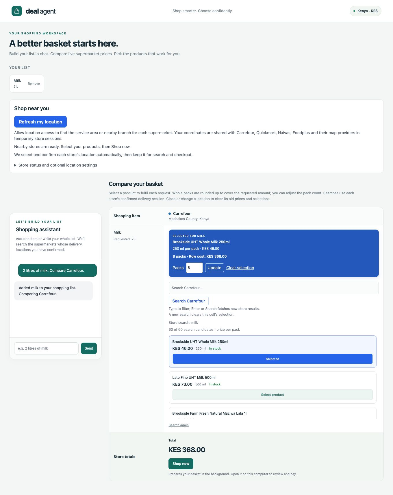

# Shopping intent, BeamAgent and store searches

The model interprets the shopper's request. Elixir validates the result, manages
the shopping list and schedules store work. Browser adapters retrieve product
data. User selection and deterministic arithmetic produce the totals.

## Walk through a request

> I want 2 litres of milk and 6 eggs. Compare Naivas and Carrefour.

1. Phoenix LiveView submits the message to `ShoppingAgent.interpret/2`.
2. `BeamAgent.API.run/2` runs the configured LLM through `CheckedClient` with the
   application tool registry. The default client uses OpenAI's Responses API.
3. OpenAI is given a strict function schema, `tool_choice: "required"` and
   `parallel_tool_calls: false`. It proposes one `capture_intent` call.
4. `CaptureIntent.execute/1` returns the normalized fields. Required-tool
   verification checks that the tool ran. `ShoppingAgent` extracts the completed
   tool result from the run trace and `IntentConverter` validates it.
5. LiveView adds milk (2 litres) and eggs (6 each), and scopes the comparison to
   Naivas and Carrefour. Store names do not become shopping items.
6. Once each store's delivery session is ready, its queue runs headless searches.
   Parsed products are normalized and returned to the matching comparison cells.
7. Selecting a product highlights the choice. Pack counts and selected subtotals
   are calculated in Elixir, including a count of unresolved rows.


The recorded live example uses a single item: “2 litres of milk. Compare
Carrefour.” It exercises intent capture, real store location confirmation,
search, selection and totals. Playwright supplies simulated GPS at the public
Greatwall Gardens/Pridelands estate centre, with the user's permission. No store
responses or model outputs are replaced. Carrefour's displayed confirmed label
was “Machakos County, Kenya”; that broad label is not a final checkout address.

On 28 October 2026 the search returned 60 candidates. Selecting Brookside UHT
Whole Milk 250 ml at KES 46 produced eight packs, totaling KES 368. The associated
completed BeamAgent run reported 750 tokens and passed verification with complete
stored evidence. Prices and result counts are observations at capture time.
The GIF samples actual browser screenshots and accelerates waiting.




The monitor capture follows another real chat request from active execution into
completed history. The dashboard is the package's own local listener, not a
recreation. Token figures come from OpenAI response usage; the capture does not
use BeamAgent's fixture/demo script. No checkout or payment is performed.

## What tool calling means here

The registry contains one tool: `capture_intent`. Its actions are `add_item`,
`add_items`, `remove_item`, `clear_list`, `compare` and `list_supermarkets`.
An illustrative tool argument payload for the message above is:

```json
{
  "action": "add_items",
  "items": [
    {"name": "milk", "quantity": "2", "unit": "litre"},
    {"name": "eggs", "quantity": "6", "unit": "each"}
  ],
  "supermarkets": ["naivas", "carrefour"],
  "name": null,
  "quantity": null,
  "unit": null
}
```

This is a schema example, not an exported production trace. After the tool
result, the OpenAI adapter completes locally with “Shopping intent captured.”
The application supplies the shopper-facing reply, avoiding a second provider
request just to phrase the acknowledgement. A closed transport connection can
trigger one HTTP retry, so one tool call is not a guarantee of one network request.

No supermarket-search, arbitrary browsing, shell or payment tool is exposed to
the model. Selecting stores through prose changes deterministic application
scope; it does not dynamically register tools.

## Guardrails and validation

`ShoppingAgent` explicitly passes these BeamAgent run limits:

- `max_iterations: 3` bounds the agent loop.
- `max_tool_calls: 1` bounds tool execution.
- `max_execution_time_ms: 100_000` sets the run execution budget. BeamAgent's API
  also has a timeout backstop with a grace period; this is not an exact browser
  request deadline or a token/cost limit.
- `verification: [required_tools: [:capture_intent]]` rejects a run that only
  produces a text reply without capturing intent.

The strict provider schema disallows additional object properties, enumerates
actions and units, and represents omitted quantities with null. This constrains
model output but does not establish that the user's meaning was understood.
Application validation still rejects unsupported stores, blank item names,
nonpositive or invalid quantities, invalid units and multi-item lists outside
1–30 items. A missing quantity stays marked unspecified internally, using one
pack as the initial selection rather than claiming the shopper requested it.

`CaptureIntent` normalizes fields; it does not perform all domain validation.
`IntentConverter` runs after BeamAgent completes. An `IntentVerifier` module
exists, but it is **not configured as the custom verifier** in this run path.
Do not confuse its presence with an enabled verification step.

Provider errors are preserved by `CheckedClient`. For a transport failure,
`ShoppingAgent` can try the local `CommandParser`; this is a limited command
fallback, not a replacement language model. Missing API keys and other failures
do not silently enable an unrestricted agent.

## Browser and calculation boundaries

Each supermarket has its own queue and parser. Carrefour and Naivas use Firefox;
Quickmart and Foodplus use Chromium. Searches depend on the store's temporary
delivery session and the current selected supermarket scope. A failed store
does not authorize searching an unconfirmed default location.

`Selection` accepts in-stock KES products with nonnegative Decimal prices.
Compatible known pack sizes are rounded up to whole packs: a 2-litre request
with a 500 ml product starts at four packs. Unknown pack sizes remain selectable
with one pack initially; the shopper must review and adjust the count. Missing
selections remain unresolved. A partial selected subtotal is not a complete
basket price or proof that a store is cheapest. Delivery fees and final checkout
conditions are outside these subtotals.

Local cart preparation can skip unselected rows, but never submits payment.
Online preview mode blocks local store-window checkout events. Foodplus checkout
is disabled pending its storefront availability and a verified cart adapter.

## Observability

BeamAgent's structured logging bridge emits run lifecycle events with an opaque
`run_key`, outcomes, durations and bounded operational metadata. The per-store
queues emit separate `supermarket.search.*` events with `search_id`, queue wait,
duration, result count and bounded failure types. These identifiers are separate;
there is no documented automatic end-to-end trace join between them.

The logging allowlist excludes prompts, tool arguments/results and coordinates
from these structured records. It is not a universal sanitizer for arbitrary log
messages. Development mode separately enables the BeamAgent dashboard on
`127.0.0.1:4080` and sanitized PostgreSQL evidence with 24-hour retention. Run the
Ecto migrations before starting it. Production retains the logging setup without
enabling this local dashboard or history connection.

The OpenAI adapter forwards provider-reported input/output usage to BeamAgent.
The local acknowledgement after intent capture supplies zero usage because no
provider call occurs; BeamAgent still counts this local client invocation among
its model-call steps. The completed dashboard's token total is provider input
plus output, not an estimate from the shopping text. Without a configured model
price schedule, cost remains **Unknown**. Expired evidence is hidden immediately;
physical cleanup uses `BeamAgent.Trace.Store.prune_expired/0`.

## Implementation and checks

- [Agent entry point](../lib/deal_agent/agents/shopping_agent.ex)
- [OpenAI protocol and schema encoding](../lib/deal_agent/llm/open_ai.ex)
- [Tool registry](../lib/deal_agent/tools/registry.ex) and [intent tool](../lib/deal_agent/tools/capture_intent.ex)
- [Domain validation](../lib/deal_agent/shopping/intent_converter.ex)
- [Pack calculation and totals](../lib/deal_agent/shopping/selection.ex)
- [Agent tests](../test/agents/shopping_agent_test.exs), [provider contract tests](../test/llm/open_ai_test.exs), [store scope tests](../test/shopping/store_scope_test.exs)

Run `mix test` for the deterministic suite. Tests use an injected LLM and fixture
store responses; they do not certify current retailer availability or consume
live provider tokens. See the README for live browser regression commands and
the deployment guide for production verification.
